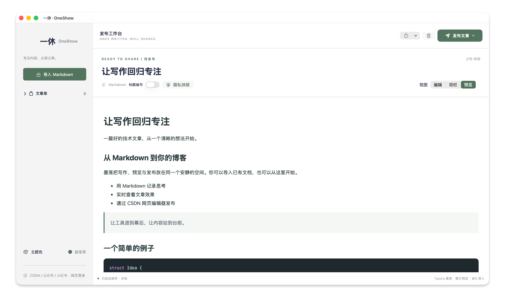

<div align="center">

# 🍃 一休 · OneShow

**Once written. Well shared.**

把写好的 Markdown，变成值得分享的内容。

**[⬇️ 下载 macOS 安装包 · v1.0.0](https://github.com/Yahoo-npu/OneShow/releases/download/v1.0.0/OneShow-1.0.0-arm64.zip)**

<sub>Apple Silicon（M 系列芯片）· macOS 14+</sub>

<kbd>macOS 14+</kbd> · <kbd>SwiftUI</kbd> · <kbd>Markdown</kbd> · <kbd>v1.0.0</kbd>

[界面预览](#screenshots) · [功能亮点](#features) · [快速上手](#quickstart) · [本地构建](#build)

</div>

---

在 Typora 专注写作，在 OneShow 预览、整理与分享。一个轻盈的 Mac 工作台，连接 **CSDN、微信公众号与小红书**。

<a id="screenshots"></a>

## 🖼️ 界面预览



<p align="center"><sub>鼠尾草主题 · Markdown 预览模式 · 让内容站到台前</sub></p>

> 🌿 清爽的工作空间，可折叠的文章库。导入一篇笔记，就可以开始预览与分享。

<a id="features"></a>

## ✨ 功能亮点

| | 你可以做什么 |
| --- | --- |
| 📥 导入即用 | 导入 UTF-8 Markdown，搜索文章、整行切换、折叠文章库，修改自动保存。 |
| 👀 舒适阅读 | 编辑、双栏与预览三种视图，支持 Typora 高亮、表格、任务列表与图片。 |
| 🎨 代码有颜色 | 本地代码块语法高亮，让关键字、字符串、注释和数字更易辨认。 |
| 🔢 标题更有序 | 六级标题自动编号，便于整理结构清晰的长文章。 |
| 🛡️ 隐私先检查 | 一键将可识别的信息替换为等字符数量的 `*`，支持当次撤销。 |
| 🌈 配色随心选 | 十种协调配色，选择自动记住，让工作台带一点自己的风格。 |

代码高亮支持 Python、JavaScript/TypeScript、Swift、Java、C/C++、Go、Rust、SQL、Shell、JSON、YAML、HTML/XML 等基础词法着色。在代码围栏后标注语言即可；未知语言与未标注的代码保持原文。

### 🌷 选一种喜欢的颜色

| 清新自然 | 安静柔和 | 温暖明快 |
| --- | --- | --- |
| 🌿 鼠尾草 · 青竹绿 | 🪻 雾丁香 · 鸢尾紫 | 🌸 蔷薇粉 |
| 🌊 松石绿 | ☁️ 晴空蓝 · 远海蓝 | 🍯 暖琥珀 |
| | 🪨 石墨灰 | |

### 🚀 一篇文章，多种分享方式

| 平台 | OneShow 帮你完成 | 在网页完成 |
| --- | --- | --- |
| **CSDN** | 打开 Markdown 编辑器，替换旧内容，自动收起 AI 侧栏；核对后点击编辑器的“发布文章”。 | 标签等必填项与最终提交。 |
| **微信公众号** | 登录后辅助进入图文编辑器、填入内容；四种文章排版主题，支持代码高亮。 | 检查图片、封面与排版，完成最终发表。 |
| **小红书** | 生成 **1080 × 1440** PNG 分页图片，支持预览、导出及官方创作平台辅助上传。 | 检查上传结果、配文并确认发布。 |

> 📌 小红书登录后的真实上传与标题填充尚未完成账号实测。也可以直接导出 PNG，在其他图文平台使用。

<a id="quickstart"></a>

## 🧭 三步开始分享

1. **📥 导入笔记** — 点击“导入 Markdown”，或按 `⌘O`。
2. **✨ 整理内容** — 检查图片和代码，按需启用标题编号、隐私抹除。
3. **🚀 选择平台** — 点击“发布文章”，完成网页登录及网页要求的操作。

本地图片以 Markdown 文件所在目录解析，原始 Markdown 文件不被修改；网络图片会按文章地址加载。

> 📝 每次进入 CSDN 发布流程，都会替换编辑器原有的标题和正文；需要保留的网页草稿请提前另存。

<a id="build"></a>

## 🛠️ 本地构建

需要 macOS 14+、匹配的 Xcode 或 Command Line Tools，以及运行测试所需的 Node.js 20+。运行时不依赖 Node.js，不需要 npm 安装依赖。

```sh
zsh scripts/test.sh
zsh scripts/build.sh
open 'dist/一休·OneShow.app'
```

构建脚本使用 `xcrun` 查找 SDK，默认生成当前机器架构的应用，可通过 `ONESHOW_ARCH=arm64` 或 `ONESHOW_ARCH=x86_64` 指定目标。本次交付验证的是 Apple Silicon 构建，未实测 Intel 运行。

如果机器存在多个 SDK，可通过 `ONESHOW_SDK_PATH` 指定与编译器匹配的 SDK；不要混用版本不兼容的编译器和 SDK。

```sh
ONESHOW_SDK_PATH=/path/to/MacOSX.sdk zsh scripts/build.sh
zsh scripts/package.sh
```

安装包输出至 `dist/release/`。应用使用本地临时签名，尚未经过 Apple Developer ID 签名和公证。

## 🗂️ 项目结构

```text
Sources/
  App/          应用入口与主题
  Models/       文章模型与示例
  Services/     文章存储、Markdown 转换、隐私规则
  Views/        SwiftUI 界面、网页承载与本地预览
  Publishing/   CSDN、微信公众号、小红书辅助发布
Resources/      离线 Markdown 解析、高亮、网页适配脚本与图标
Config/         应用 Info.plist 与版本
Tests/          JavaScript 与 Swift 测试、合成示例
scripts/        测试、构建、打包
docs/           架构、隐私与发布指南
```

根目录是唯一维护的源码入口。`outputs/` 和 `work/` 是本地历史交付和调试资料，已被 Git 忽略，不应上传到仓库。

## 🔎 数据与使用边界

- 为兼容旧版，文章仍保存在 `~/Library/Application Support/Mojian/articles.json`，应用标识保持 `studio.mojian.mac`。主题和折叠状态保存在应用偏好中。升级不会主动清空文章库。
- 登录会话由 WebKit 保存，程序不导出 Cookie、不要求 AppSecret、不调用平台的私有发布接口。
- 隐私抹除是规则匹配，不能保证发现全部敏感信息；发布前应检查正文、图片和代码。
- 当前没有公式、Mermaid、脚注专用渲染器，基础词法着色不等同于完整语言解析器。
- 本地图片不能直接用于远程文章，需要在平台上传或替换为可访问的 HTTPS 地址。外链图片可能因权限或防盗链失败。
- 小红书登录后的真实上传与标题填充尚未完成账号实测；可导出 PNG 后手动上传。超长文章可能需分批，应用最多生成 100 页，并非平台上传额度。
- 网页结构变化可能影响自动填入；失败时不会继续点击最终提交。以平台显示的发布结果为准。

更多说明：[架构](docs/architecture.md) · [隐私与安全](docs/privacy.md) · [GitHub 发布](docs/releasing.md) · [更新记录](CHANGELOG.md)。

## 📄 许可与第三方

`marked` 的第三方许可保留在 [Resources/marked-LICENSE.md](Resources/marked-LICENSE.md)。项目自身尚未指定开源许可证，公开源码不等于授予开源许可；首次公开发布前应由维护者选定许可。图标及其他资源也需随选定的许可明确授权范围。
